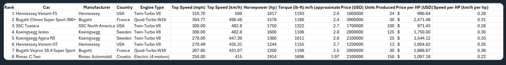

| [Home Page](https://christinelin10.github.io/christinelin-portfolio/) | [Data Viz Examples](dataviz-examples) | [Critique by Design](critique-by-design) | [Final Project I](final-project-part-one) | [Final Project II](final-project-part-two) | [Final Project III](final-project-part-three) |

# Critique by Design: 8 Fastest Cars in the World, 2026
[MakeoverMonday](https://makeovermonday.vercel.app/)

This page documents my critique and redesign of a visualization of the world's fastest production hypercars as of 2026, from choosing the original chart through critique, sketching, user testing, and a final redesign in Tableau.

## Step One: The Visualization

[Original Data Visualization](https://makeovermonday.vercel.app/dataset/8-fastest-cars-in-the-world-as-of-2026)

I chose this data visualization because it is barely a visualization at all. It is essentially a table of information about the eight fastest cars in the world. The table is transparent, accurate, and easy to read, but it leaves the work of finding patterns to the audience. This is what I believed would make it a good candidate for a redesign. All of the information is there; however, there is nothing about the design that helps the audience see what is interesting about it. It also seemed most useful for people who are already interested in cars and actively looking for this information, but, and on the flip side, incredibly less engaging or enticing for anyone else. I wanted to see whether a redesign could make the data more visually appealing and draw in a wider audience. 

The dataset covers eight production cars -- the fastest cars in the world as of January 2026. The dataset lists ten key features: car name, car manufacturer, country of origin, engine type, top speed in miles per hour (mph), top speed in kilometers per hour (km/h), horsepower, torque, price, and the number of units produced. The dataset also lists a few calculated columns, like price per horsepower and speed per horsepower. 

## Step Two: The Critique
Using Stephen Few's Data Visualization Effectiveness Profile, my main observation was that there is little to no data visualization here. The original is essentially a table of information; however, coming from a quantitative background, this has some true strengths. The data is fully transparent, accurate, easy to read, and easy to understand. Every data point is visible, and nothing is hidden. This is why I rated its Completeness at a 9/10. I only docked 1 point because one of the calculated columns is not fully labeled. 

Where the dataset fails is in turning the information into insight -- i.e. telling a story. Because it is a table, the reader has to compare numbers row by row to find any patters, and nothing in the design draws attention to what is interesting or surprising in the data. It is, as previously mentioned, not very visually engaging. This is why I rated it a 1/10 in Aesthetics. I would have given it a 0/10, but this was not an option. 

The primary audience appears to be people who are already interested in cars and may be searching for the listed metrics. For them, I'm sure the table is fairly effective, since they are looking for this information, will take the time to read and compare manually, and deeply understand what the table is truly representing. However, for the average audience member, the table is not an effective design that draws anyone else in. 

Based on this critique, I decided to focus my redesign on making the data more visually appealing and exciting, with the question of "fastest" at the center. 

## Step Three: Sketch a Solution

<noscript></noscript><object class='tableauViz'  style='display:none;'><param name='host_url' value='https%3A%2F%2Fpublic.tableau.com%2F' /> <param name='embed_code_version' value='3' /> <param name='site_root' value='' /><param name='name' value='car_first_sketch_mm&#47;Sheet1' /><param name='tabs' value='no' /><param name='toolbar' value='yes' /><param name='static_image' value='https:&#47;&#47;public.tableau.com&#47;static&#47;images&#47;ca&#47;car_first_sketch_mm&#47;Sheet1&#47;1.png' /> <param name='animate_transition' value='yes' /><param name='display_static_image' value='yes' /><param name='display_spinner' value='yes' /><param name='display_overlay' value='yes' /><param name='display_count' value='yes' /><param name='language' value='en-US' /><param name='filter' value='publish=yes' /></object>
                

This first draft 'sketch' is a scatterplot of Top Speed (mph) vs Horsepower with each car colored to represent the engine type. This sketch responds to the main weakness I found in my critique: the table did not tell a story. Plotting these tow columns against each other makes the relationship between speed and horsepower visible at a glance. It is interesting to note that the most powerful car, the Rimac C Two, has the lowest top speed making me think that it is the 'slowest.' This sketch suggested that the more interesting story in this data is the question and definition of what 'fast' really is, which became the starting point for my final rendition. 

## Step four: Test the solution

I showed my Step Three sketch (Top Speed vs Horsepower scatter plot) to two people without explaining it first. 
Then I asked the following questions and received the following responses, in short. 

Results: 

| Question | Interview 1 | Interview 2 |
| |(First year MISM student and TSWD classmate)|(Second year MISM student and TSWD classmate)|
|----------|-------------|-------------|
| Can you tell me what you think this is? | A graph about some cars' top speeds versus horsepower | Same as Interview 1 |
| Can you describe to me what this is telling you? | Just about the top speed and horsepower of cars. | The cars are probably very expensive and are supposed to be very fast. |
| Is there anything you find surprising or confusing? | I do not understand why the dots are different colors | (Pointed out the color legend) I am confused why we are only looking at these 8 cars |
| Who do you think is the intended audience for this? | People who enjoy cars | Same as Interview 1 |
| Is there anything you would change or do differently? | The data seems very dry | I think the engine information may not be necessary unless this is specifically for someone who understands cars |

Synthesis: 

Both interviewees quickly recognized that the scatter plot is a comparison of top speed and horsepower, and both identified the audience as people who have a dedicated interest in cars. However, neither of them noticed the most important finding in the sketch: that the most powerful car, the Rimac C Two, has the lowest top speed of the eight. Both described the chart to me in general terms, which tells me that the main insight was not coming through on its own. If audience members need me to point out the story, then the design is not doing its job. 

The engine type coloring also did not help. The first interviewee did not understand why the dots were different colors, and the second suggested the engine information was unnecessary unless the audience already knows about cars. Since my critique of the original focused on reaching a wider audience other than car enthusiast, engine type was an unnecessary inclusion that added complexity without meaning. 

Finally, the interviewees' answers suggested that the numbers felt abstract. One described the data as "very dry," and the other's takeaway was simply that the cars are "supposed to be very fast." Neither said what the numbers meant in practical or real world terms, which suggests that a top speed of 300mph or a horsepower metric is hard to conceptualize. The second interviewee also asked why only these eight cars were included, so I believe the next visualization needs to include the superlative of fastest cars again. 

Design changes for final redesign:
- Remove engine type coloring; possibly use color to highlight the cars that matter
- Make speed tangible
- State in title that these are the eight fastest cars in production
- Tell story about definition of 'fast'

## Step five: build the solution

<noscript></noscript><object class='tableauViz'  style='display:none;'><param name='host_url' value='https%3A%2F%2Fpublic.tableau.com%2F' /> <param name='embed_code_version' value='3' /> <param name='path' value='shared&#47;5J6FT87DF' /> <param name='toolbar' value='yes' /><param name='static_image' value='https:&#47;&#47;public.tableau.com&#47;static&#47;images&#47;5J&#47;5J6FT87DF&#47;1.png' /> <param name='animate_transition' value='yes' /><param name='display_static_image' value='yes' /><param name='display_spinner' value='yes' /><param name='display_overlay' value='yes' /><param name='display_count' value='yes' /><param name='language' value='en-US' /><param name='filter' value='publish=yes' /></object>
                

### What the redesign shows
My final redesign turns the original table into a race. Each of the eight fastest production cars gets its own lane, and audience can drag a slider to set the length of the race, from 0 to 40 seconds. As the slider moves, each car travels the distance it would cover in that time. The result shows that "fastest" depends on how you measure it. 

The Rimac C Two, which has the lowest top speed of the eight, wins short races because it accelerates the quickest (0–100 km/h in 1.97 seconds). The Bugatti Chiron Super Sport 300+ takes the lead in the middle of the race. Lastly, the Hennessey Venom F5, the car with the top overall speed, only pulls ahead in races longer than about 38 seconds.

### How I got here
My critique, using Stephen Few's Data Visualization Effectiveness Profile, found that the original was essentially a table. It was accurate and easy to read, but it left all the work of finding patterns to the reader and mainly served people who were already interested in cars. The critique pushed me to look for a story hidden between the columns rather than simply charting top speed.

My first sketch, a scatter plot of top speed against horsepower, revealed one of those hidden relationships: the most powerful car is the slowest. But user testing showed that the insight was not coming through. Neither interviewee noticed the Rimac's surprising lack of measurable long term top speed. Additionally, one was confused by the engine-type colors, and the other felt the engine information was unnecessary for a general audience. Both treated the numbers as abstract, and one asked why only these eight cars were included.

Based on that feedback, I made four changes: 
- I removed engine type from the color encoding and used color only to highlight the three cars that lead the race at some point.
- I added a headline that states the main insight directly
- I made speed tangible by showing distance traveled over time instead of abstract top-speed numbers
- I stated in the title that these are the world's eight fastest production cars.

### What I did differently
The original asked readers to compare numbers in a table. My redesign asks a question ("which car is fastest?") and lets readers discover the answer by interacting with it. It also brings in the acceleration column, which the original table listed poorly (as some of the column title was cut off) but did nothing with, and which turned out to hold the most surprising part of the story.

Because the dataset only includes top speed and 0–100 km/h time, the distances are estimates from a simplified model. It assumes each car keeps its 0–100 km/h acceleration until it reaches its respective top speed, then the model assumes that the car holds that speed indefinitely. I noted this on the visualization so readers do not mistake it for real-world performance. With more time and time-based performance data, I would love to build a more realistic race.

## References
- Original data visualization: #MakeoverMonday, "8 Fastest Cars in the World as of 2026," https://makeovermonday.vercel.app/dataset/8-fastest-cars-in-the-world-as-of-2026

## AI acknowledgements
I used AI to assist me in making the parameters, calculated fields, and adding the animation to the final sketch in Tableau. 

